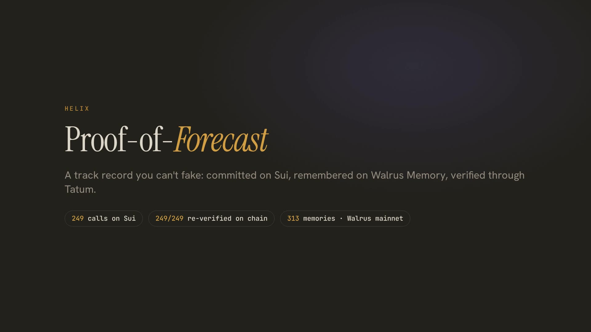
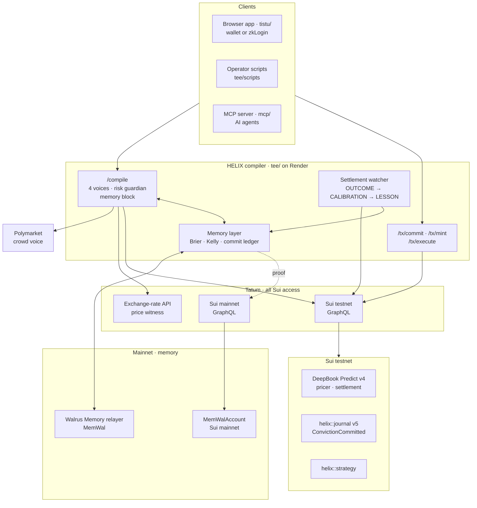

# 🧬 HELIX

### Proof-of-Forecast on Sui: a track record of judgment that can't be faked, remembered on Walrus, verified through Tatum

---

[](https://github.com/harsh11067/helix/actions/workflows/ci.yml)
[](./blog.md)
[](./blog.md)
[](./docs/TATUM.md)
[](./LICENSE)
[](./TOTAL_RECALL_EVIDENCE.md)

> [!IMPORTANT]
> **HELIX is Proof-of-Forecast: a track record of judgment you can't fake, that learns, and that people and agents can pay to trust.**
> Every call is hashed onto Sui before its market settles, remembered on **Walrus Memory (mainnet)**, settled against DeepBook Predict through **Tatum**, and scored — for you, the market, a model, the crowd and a Council of agents. Nothing can be backdated, and no losing call can be hidden.

[](docs/media/helix-demo.mp4)
*The 2:58 demo, recorded from the live site with every number pulled from production at recording time (10 Nov, 16:51 IST): [docs/media/helix-demo.mp4](docs/media/helix-demo.mp4) · captions [helix-demo.srt](docs/media/helix-demo.srt) · 20-second teaser [helix-launch.mp4](docs/media/helix-launch.mp4). How it was made: [`video/`](./video) (Argo + Playwright + Kokoro TTS + ffmpeg).*

**Live now:** [app](https://helix-app-fovn.onrender.com/app.html) · [demo trader's passport](https://helix-app-fovn.onrender.com/passport.html?id=helix-v1-4d922636976d) · [the Council](https://helix-app-fovn.onrender.com/app.html#/council) · [live proof ticker](https://helix-compiler.onrender.com/proof/ticker) · [chain audit](https://helix-compiler.onrender.com/proof/audit) · [Tatum Ops panel](https://helix-app-fovn.onrender.com/ops.html) · [the story (blog)](./blog.md) · [where this goes](./PRODUCT.md)

> **Judging snapshot:** git tag [`v1.0.1-total-recall`](https://github.com/harsh11067/helix/releases/tag/v1.0.1-total-recall) is the submitted version (`v1.0-total-recall` + a Tatum-credit saving for idle hours); the live services run it. Numbers in this README, the blog and the video are as of **10 Nov 2026, 16:50 IST**; the live pages keep counting.

---

## ⚖️ Judges: try in 60 seconds

No wallet needed. (The free-tier compiler may take ~50 s to wake on the first request.)

1. **Open the demo trader:** [helix-app-fovn.onrender.com/app.html?demo=1#/memory](https://helix-app-fovn.onrender.com/app.html?demo=1#/memory) — a real trader's convictions, outcomes, calibration and lessons, recalled live from **Walrus Memory (mainnet)**, read-only.
2. **Check any memory:** click a blob id → **Walruscan mainnet**; click *verify on mainnet* → the MemWal account read through **Tatum's mainnet gateway** plus the blob from the Walrus mainnet aggregator.
3. **Watch it learn:** on the same Memory page, press **▶ Replay** on the *memory time machine*: the page re-renders from only the memories that existed at each moment — the over-confidence gap opening, Brier per voice settling, memory's suggestion tightening. (The Council page has its own time machine for the agents' weights.)
4. **See memory change the product:** open the **Canvas** (still in demo mode) and set a confident bullish call in a choppy market — *you set X · memory suggests Y*, the five voices, the **Memory** line in the risk guardian, and the demo trader's own **Ulysses rule** turning into a gate: *"Cap my commit at 2 dUSDC when my over-confidence gap in this setup is over 30 points"*. Committing past it takes a typed override, which is remembered (`OVERRIDE v1`) and scored.
5. **See Tatum is the chokepoint:** the [**Ops panel**](https://helix-app-fovn.onrender.com/ops.html) (click the *sui testnet · tatum* chip in the app) shows calls per hour per Tatum interface (GraphQL and gRPC, testnet and mainnet, plus the rates API), p50/p95 latency, cache hits, the credit runway, and **direct fullnode calls by HELIX: 0** — counted, not promised.
6. **Open a Forecaster Passport:** [the demo trader's](https://helix-app-fovn.onrender.com/passport.html?id=helix-v1-4d922636976d) — *committed N · shown N · hidden N*, counted from Sui events (its hidden count is not zero, and the passport says why). Press **Verify all**: your browser fetches each commit from Sui itself and re-hashes the remembered call, and the server confirms the same transaction through **Tatum's gRPC interface** — a row turns ✓✓ *verified via 2 Tatum interfaces* only when both match. Settled rows also show how many independent prices agree with the settlement (*3 price sources agree ✓*: Predict oracle, Pyth, Tatum). **Freeze a signed copy on Walrus** stores a signed snapshot of the passport as a Walrus blob — [here is one](https://helix-app-fovn.onrender.com/passport.html?report=aJ9wNCpB6XUvGDkkYd261wpr9JUggd3cMW1ghPDpqi8), verified in your browser from the Walrus aggregator. The same record is a **soulbound passport object on Sui** ([Suiscan](https://suiscan.xyz/testnet/object/0xa8d8500dd363468edaab8e011deeb7243c2f9fcddb20d23f9e858f45c6089790)), signed by HELIX and verified on-chain.
7. **Check the chain audit:** [`/proof/audit`](https://helix-compiler.onrender.com/proof/audit) — every commit ever made, re-fetched as a transaction through Tatum and checked: it exists, succeeded, was sent by the committer, carries the same hash, and landed **before** its market's expiry (consensus time, not the contract's clock). Re-run every 30 min.
8. **Watch the Council:** [four agents](https://helix-app-fovn.onrender.com/app.html#/council) commit every half hour with their own keys and memory; their weights move as memory scores them.
9. **Commit as yourself:** connect a wallet (or Google/zkLogin) and press **Commit conviction** — no USDC needed, and if your address has no testnet SUI, HELIX sponsors the gas for that one `journal::commit`. The demo is read-only, so committing and minting unlock only for your own address.

## 🏗️ Architecture



A conviction is compiled against DeepBook Predict's live on-chain pricer, then either **committed** (`journal::commit` stores the sha256 of the conviction before the window settles; gas only) or **minted** as a real Predict order. Either way, HELIX writes it to **Walrus Memory on mainnet**. When the window settles, the watcher reads the settlement through **Tatum**, checks the hash, scores all four voices, and writes the outcome, the new calibration and any lesson back to memory. The next compile reads that memory.

---

## 🧠 Total Recall — new during 20 Oct – 10 Nov 2026

HELIX existed before this hackathon (Move package, DeepBook Predict integration, Seal theses, zkLogin). **Everything below was built in the build window** — the commits on branch `total-recall` are the record.

**HELIX now remembers who was right.** Every conviction carries up to four probability calls on the same outcome — **you** (your confidence), the **Predict market** (implied by DeepBook Predict's on-chain SVI pricer), **HELIX's regime model**, and, when the windows match, the **Polymarket crowd**. Each call, each settled outcome, each recalculated calibration score and each lesson is written to **Walrus Memory on mainnet**, and the next compile visibly changes because of it.

| New in the window | Where |
|---|---|
| **Tatum single chokepoint** — every Sui read, event query and transaction execution goes through Tatum's Sui gateway (GraphQL; Sui retired public JSON-RPC in 2026). Testnet for trading, mainnet for memory proofs. Free-plan rate limit (3 req/s) respected by a serialized queue with jittered backoff and a 2s read cache. The browser never sees the key. | `tee/src/shared/tatum.ts`, `/graphql`, `/rpc`, `/tx/execute` |
| **DeepBook Predict v4** (redeployed 2026-09-12: queued orders filled by a keeper at Pyth's price) — live pricer snapshot, admissible directional / bracketed-range / range orders, server-built PTB that places the Predict order **and** mints the HELIX strategy object in one signature | `tee/src/predict/` |
| **Walrus Memory layer** — CONVICTION / OUTCOME / CALIBRATION / LESSON records, hashed namespaces, Beta(2,2) posterior, Brier per voice, ¼-Kelly commit suggestion, structure bias | `tee/src/memory/` |
| **Commit mode** — the user signs `helix::journal::commit(sha256(conviction), market, expiry)` before the window settles (gas only, no USDC). The CONVICTION memory carries the hash and commit digest; at settlement the watcher re-hashes the memory (`reveal_ok`). Calibration is checked against **every** `ConvictionCommitted` event the address emitted, so a hidden losing call shows up as `missing_memory` and counts as a loss | `contracts/sources/journal.move`, `tee/src/memory/commit.ts`, `/tx/commit`, `/memory/conviction` |
| **Settlement watcher** — resolves every commit and every filled order at expiry, writes OUTCOME → CALIBRATION → LESSON; rebuilt from Walrus Memory on restart (no duplicate writes) | `memory/service.ts` |
| **Memory changes the compile** — "you set X · memory suggests Y" with one-click accept (never silent), memory-preferred structure, a 4th guardian class *Memory* in plain language | Canvas |
| **Memory page** — timeline with every Walrus blob id and an inline **mainnet proof** (MemWal account read via Tatum mainnet + blob fetched from the Walrus mainnet aggregator), Brier per voice, reliability diagram, memory dividend, who-to-trust board | `tistu/js/memory-ui.js` |
| **The Council** — four rule-based agents (Momentum, Reversion, Surface, Crowd), each with its own Sui key, gas and Walrus Memory, commit on every 15-minute BTC window twice an hour. Memory weights them (∝ 1/Brier, equal until n ≥ 5, a `COUNCIL` memory per settled window); the Council becomes a fifth voice in every compile — the market's own surface re-centred on the agents' edge — and is scored like any voice | `tee/src/council/`, `#/council` |
| **Forecaster Passport** — a public, signed record for any forecaster or agent: committed / shown / **hidden** counted from chain events, best and worst setup, latest lesson, badges, every commit with a one-click in-browser **Verify** (WebCrypto sha256 vs the on-chain hash). Ed25519-signed JSON (attestor key at [`/.well-known/helix-attestation.json`](https://helix-compiler.onrender.com/.well-known/helix-attestation.json)), share card, embeddable badge | `tee/src/passport/offchain/`, `passport.html`, `/passport/:id` |
| **On-chain Forecaster Passport** — `helix_passport`: a **soulbound** object (no `store`) minted from HELIX's BCS attestation and checked with `ed25519::ed25519_verify` on-chain, anti-rollback refresh, one per address, Display for wallets, and `gate_example::assert_calibrated` so any protocol can gate on reputation | `contracts-passport/`, `tee/src/passport/onchain/` |
| **Credibility API, paid per call** — the Passport's per-setup detail behind HTTP **402** with the Machine Payments Protocol on Sui (`@suimpp/mpp` + `mppx`): pay → sign the proof → retry → 200 + receipt. Verification re-reads the payment **through Tatum**; replay-proof across restarts. The Council's **allocator** agent pays to read a human forecaster's record and decides whether to admit them (Brier ≤ 0.22, n ≥ 8) — memory buys memory | `tee/src/payments/`, `#/api`, `/api/v1/credibility/:id` |
| **Ask your memory** — Walrus Memory's own `ask` (called from Node with HELIX's delegate key), with a deterministic stats fallback; every number in an answer must appear in the memories it cites, which are linked to Walruscan | `tee/src/ask/`, header button |
| **More than BTC** — ETH and SUI convictions in commit mode, resolved by **Pyth**: the first price at or after expiry from Pyth's Hermes API (VOID past 300 s), with Pyth's signed on-chain updates on Sui (read through Tatum) as the keyless fallback for SUI. Voices that don't exist for an asset show *n/a*; buckets are asset-scoped so BTC history is untouched. DeepBook Predict v4 lists only BTC (checked on-chain) | `tee/src/assets/`, Canvas asset switcher |
| **Chain audit through Tatum** — every `ConvictionCommitted` ever emitted is re-fetched as its own transaction (20 per batched GraphQL request) and checked independently of the event index: found, succeeded, sender = committer (sponsored commits included), same hash / market / expiry, checkpoint time before expiry, Move Clock within 60 s. Runs every 30 min; the ticker shows *audited N/N* | `tee/src/fun/audit.ts`, `/proof/audit` |
| **Price witness for every asset** — Tatum's exchange-rate API checks the settlement price of BTC (vs DeepBook Predict) and of ETH and SUI (vs Pyth): a guardian line at compile time and `witness_usd` / `witness_bps` on every OUTCOME memory | `tee/src/shared/tatumRates.ts` |
| **Honest hidden count** — a commit is called hidden only after memory has been searched completely and the record has been looked up by its exact digest; until then the count is *checking*, never a guessed 0 | `memory/store.ts`, `memory/service.ts` |
| **Fast** — the Sui SDK is vendored as 6 code-split bundles (was ~236 esm.sh modules), the wallet chip appears on approval, the payoff curve follows the commit slider in 4 ms, and the server never makes a compile wait on Tatum for data a few seconds old (stale-while-revalidate) | `tistu/js/vendor/`, `predict.ts`, `store.ts` |
| **Memory Time Machine** — a scrubber on the Memory and Council pages replays every page from only the memories that existed at a moment (same calibration module in the browser as on the server, bundled from `tee/src/memory/`); key moments marked: first lesson, first n ≥ 3 setup, biggest weight change. At "now" it equals the live page exactly (tested) | `tistu/js/timemachine.js`, `/memory/:address/history` |
| **Ulysses Rules** — promises to your future self, kept by memory: four rule templates (cap the commit when your gap is high, cool down after losing streaks, justify calls against the market, a daily limit), each a signed `RULE v1` memory. A matching rule turns the guardian line into a gate; committing anyway takes a typed override (`OVERRIDE v1`), and memory scores your overrides (*you broke your own rules N times and won M*) | `tee/src/memory/rules.ts`, `rulesService.ts`, `tistu/js/rules-ui.js` |
| **Two Tatum interfaces per proof** — Tatum's Sui **gRPC** (`sui-testnet-grpc` / `sui-mainnet-grpc.gateway.tatum.io`, `sui.rpc.v2`) next to GraphQL: Passport *Verify* re-reads each commit via `LedgerService/GetTransaction` (BCS event decoded) and shows ✓✓ only when both interfaces match; memory proofs read the Walrus Memory account via `GetObject` as well (`via: [tatum-graphql-mainnet, tatum-grpc-mainnet]`) | `tee/src/shared/tatumGrpc.ts`, `/verify/:digest/grpc` |
| **Tatum Ops panel + credit runway** — every call counted at the chokepoint by interface and operation; `/health` projects when the free plan's credits run out; the watcher is expiry-driven, the Council and passports share one incremental event log, and **degrade mode** serves cached reads and pauses writes (with a banner) if Tatum refuses the key — never a silent public fullnode | `tee/src/shared/tatumUsage.ts`, `ops.html`, `/ops/tatum` |
| **Three price sources per settlement** — BTC outcomes record the Predict oracle's settlement, Pyth's first Hermes price at expiry and Tatum's rate; ETH/SUI record Pyth and Tatum. Passport rows show *3 price sources agree ✓ · ≤X bps*, in red when they don't | `memory/service.ts`, `passport.js` |
| **Rematch with memory's size** — every LOSS on the Memory timeline has *↺ Rematch*: one click re-opens the Canvas with the same setup, and the first compile applies memory's suggested commit (said in a toast, one click to undo) | `tistu/js/memory-ui.js` |
| **Forecaster Report, frozen on Walrus** — one click signs a snapshot of a passport (Ed25519 over canonical JSON, the published attestor key), stores it as a Walrus blob and writes a `REPORT v1` memory pointing at it. `passport.html?report=<blob>` fetches it straight from a Walrus aggregator and checks the signature in the browser; `tee/scripts/verify-report.mjs` does it offline. The record outlives HELIX's servers. [Example report](https://helix-app-fovn.onrender.com/passport.html?report=aJ9wNCpB6XUvGDkkYd261wpr9JUggd3cMW1ghPDpqi8) | `tee/src/passport/offchain/report.ts`, `POST /passport/:id/report` |
| **Memory mirror** — every record HELIX has recalled (blob id + exact text) is snapshotted and preloaded, so Walrus Memory's top-k search variance can't flip a remembered call to "hidden"; a mirrored record counts only while its blob is still listed on the account | `tee/mirror/`, `scripts/memory-mirror.mjs` |
| **Fun layer, all from data** — live proof ticker, settlement countdown + hash-verified reveal, humility meter (confidence vs record, n ≥ 3), Beat the Market (today, shared windows only) | `tistu/js/fun.js`, `/proof/ticker` |
| **W1 Crowd voice** (Polymarket BTC 15-min Up/Down, compared only when windows and strikes match) · **W2 Price witness** (Tatum exchange-rate API) · **W3 Memory dividend** · **W5 MCP server + agent skill** · **W6 opt-in reasoning memory** · **W7 who-to-trust board** | see [WIN_FEATURES.md](./WIN_FEATURES.md) |

Verify it yourself:

**One command, no keys:** `cd tee && npm ci && node scripts/verify-all.mjs` — checks the chain audit, the passport's signature, three random commits re-hashed on *your* machine and compared with Sui over two Tatum interfaces (GraphQL + gRPC), the latest frozen report straight from Walrus, and a memory proof on Walrus mainnet (7/7 on 10 Nov).

```bash
C=https://helix-compiler.onrender.com
curl -s $C/health | jq '{tatum_testnet_checkpoint, tatum_mainnet_checkpoint, memwal, memory_network}'
curl -s -X POST $C/rpc -H 'content-type: application/json' -d '{"jsonrpc":"2.0","id":1,"method":"unsafe_transferSui","params":[]}'   # 403 — allowlisted
curl -s $C/memory/<address> | jq '.timeline[] | {type, blob_id}'            # recalled from Walrus Memory (mainnet)
curl -s $C/memory/<address>/proof/<blob_id> | jq .verdict                   # read back through Tatum mainnet
curl -s $C/proof/audit | jq '{audited, ok, passed, min_lead_s, tatum_requests}' # every commit re-verified through Tatum
cd tee && node --env-file=../.env scripts/verify-ledger.mjs                 # every memory → a SUCCESS tx + a mainnet blob
```

Evidence (health output, every memory with its blob id and source tx, before/after compile): [TOTAL_RECALL_EVIDENCE.md](./TOTAL_RECALL_EVIDENCE.md).

### How HELIX uses Tatum

| Tatum product | What HELIX does with it |
|---|---|
| **Sui gateway, testnet (GraphQL)** | Every read the app makes: Predict markets and pricer, wallets' objects and coins, `ConvictionCommitted` events, Pyth's SUI price updates, payment verification for the paid API, and the chain audit. One server-side queue at the free plan's 3 req/s with jittered backoff; the browser reaches Sui only through HELIX's allow-listed `/graphql` proxy, so the key never leaves the server |
| **Sui gateway, testnet (execute)** | Every transaction HELIX lands: commits, sponsored commits, Predict orders, passport mints, agent and allocator payments (`/tx/execute`, logged with the gateway host) |
| **Sui gateway, mainnet** | Memory proofs: the Walrus Memory account object read on mainnet next to the blob from the Walrus mainnet aggregator |
| **Sui gateway, testnet (gRPC)** | The second interface behind every Passport *Verify*: `sui.rpc.v2.LedgerService/GetTransaction` re-reads the commit (BCS event decoded), so a row is ✓✓ only when GraphQL and gRPC agree |
| **Sui gateway, mainnet (gRPC)** | `LedgerService/GetObject` reads the Walrus Memory account in every memory proof, next to the GraphQL read |
| **Exchange-rate Data API** | The price witness: BTC, ETH and SUI checked against the oracle at compile time and stamped on every outcome |

Live usage, latency and the credit runway: [Ops panel](https://helix-app-fovn.onrender.com/ops.html) · details in [docs/TATUM.md](./docs/TATUM.md).

### Feature flags (live values on the deployed service)

| Flag | Live | What it gates |
|---|---|---|
| `FEATURE_COUNCIL` | on | the four Council agents and the allocator |
| `FEATURE_PAYMENTS` | on | the paid Credibility API (HTTP 402, MPP on Sui) |
| `FEATURE_ONCHAIN_PASSPORT` | on | the soulbound passport mint/refresh |
| `FEATURE_ASK` | on | *Ask your memory* |
| `FEATURE_ASSETS` | on | ETH and SUI convictions (commit mode, settled on Pyth) |
| `FEATURE_TIMEMACHINE` | on | the Memory and Council time machines |
| `FEATURE_RULES` | on | Ulysses Rules and the rule gate |
| `FEATURE_WITNESS` | on (default) | the Tatum price witness |

### Honest limits

- HELIX positions trade on **Sui testnet** (DeepBook Predict v4 testnet, test USDC). **Memory is written on Walrus Mainnet.**
- DeepBook distributes Predict v4 test USDC manually, so most recorded convictions are **commit-mode** (paper) convictions: the hash is committed on-chain before settlement, and the payoff shown is what the structure **would have paid** at the quoted price. Real minted orders are labeled **On-chain** on the Memory page.
- Memories are written by the HELIX service's Walrus Memory account with an **operator-held delegate key**; the hosted relayer embeds and Seal-encrypts, so **the relayer sees plaintext**. User-owned memory spaces are roadmap.
- Calibration with small n is noisy. A Beta(2,2) prior and an n ≥ 3 gate keep early numbers conservative, and the UI always shows n.
- HELIX's own voice is a transparent **heuristic** (regime-tilted market probability), labeled as such; memory scores it like any other voice.
- The crowd comparison covers only at-the-money directional bets over matching 15-min windows; everything else is marked "not compared". Polymarket resolves on a Chainlink TWAP, Predict on Pyth at expiry. Polymarket may be unreachable from some networks — HELIX then shows "unavailable", never a number.
- Indicative payouts on the Canvas use a fee model fitted to Predict quotes; the exact cost and fees come from Predict's own plan at signing. Memory-dividend counterfactuals ignore fills and slippage.
- Some convictions were placed by an operator script (`tee/scripts/commit-campaign.ts`, `tee/scripts/mint-conviction.ts`) on the same server path as the browser; every such memory is tagged `origin=cli`.
- Gas for `journal::commit` is sponsored from a dedicated low-value testnet key when the committer has no SUI. The sponsor co-signs only a lone `journal::commit` with a capped budget, and only a limited number per address per day.
- The paid Credibility API charges in **testnet SUI** today (we hold no Circle testnet USDC); `PAYMENT_CURRENCY=USDC_TESTNET` switches it to Circle USDC with no code change.
- *Ask your memory* sends the question and the matching memories (decrypted by the relayer) to the relayer's model; HELIX checks every number in the answer against the cited memories and falls back to stats otherwise.
- ETH and SUI are commit mode only (no DeepBook Predict market): they settle on Pyth's price, and the market voice is *n/a*. The Council commits on BTC only.
- Walrus Memory recall is semantic top-k search, so it can't list a large namespace on its own, and its results drift between calls (on 10 Nov, 35 of the demo trader's 307 listed blobs weren't returned by any query; `restore` saw only 36 candidates because of the relayer's per-owner cap). HELIX pages through `listMemories`, recalls in chunks, looks up unmatched commits by exact digest, and keeps a **mirror** of every record it has ever recalled. The demo trader's passport shows **hidden 4** (as of 10 Nov 16:50 IST): one commit whose memory was never written (a server restart between commit and write — deploys now drain in-flight writes on SIGTERM), and commits whose memories were written (blob ids in the logs) but which search no longer returns, conviction and outcome alike. A commit whose OUTCOME memory says `reveal_ok=true` was re-hashed against the chain by the settlement watcher, so it counts as *verified at settlement* — remembered, not hidden — and its passport row says the text can't be re-checked in the browser. We also tried decrypting such blobs directly from Walrus with Seal and our delegate key (`tee/scripts/decrypt-memory.ts`): the relayer seals to a committee key server whose aggregator URL isn't exposed, so a client can't read its own memories without the relayer.
- The demo trader holds two Ulysses rules; it is a script, so when a rule binds it commits anyway with an override sentence saying exactly that (`origin=cli`), and memory scores those overrides like anyone else's.
- Hardware TEE attestation remains a labeled dev stub (unchanged).

---

### 🚀 Live URLs

```text
┌────────────────┬─────────────────────────────────────┬──────────────────────────────────────────────────────────┐
│                │                 URL                 │                          Status                          │
├────────────────┼─────────────────────────────────────┼──────────────────────────────────────────────────────────┤
│ App (frontend) │ https://helix-app-fovn.onrender.com │ HTTP 200 — landing + /app.html                           │
├────────────────┼─────────────────────────────────────┼──────────────────────────────────────────────────────────┤
│ Compiler (TEE) │ https://helix-compiler.onrender.com │ /health ok, warm /compile 1.15s against real testnet SVI │
└────────────────┴─────────────────────────────────────┴──────────────────────────────────────────────────────────┘
```

* **On-Chain Package — `published-at` (latest, v5, adds `journal`):** `0x5bcf3bf66f6c71f53aaf681842b554edde5b6c141c7315ba0ac6b4cd6766652f`
* **On-Chain Package — `original-id` (v1, type/identity namespace):** `0xdc4b27696494c3c5f54513b19781686f7354a7b09f7ccf2285f7b843c7add2b3`
* **Real Walrus Testnet Blob:** `QE8njhhplCR8s6UHqjS8SBsQ6SO7AxyNZqI6CoBvmX4`
* **Full on-chain proof, IDs, tx digests & explorer links:** [DEPLOYMENT.md](./DEPLOYMENT.md)

> [!NOTE]
> The package has been upgraded **five times** on testnet (v1 publish → v2 Seal policy → v3 cross-wallet copy → v4 copier-access fix → v5 `journal` commit–reveal). Always use `published-at` for `moveCall` targets and `original-id` for type/event identity. The full lineage is in [DEPLOYMENT.md](./DEPLOYMENT.md).

---

## 📑 The Document Set

| Document | What it is |
| :--- | :--- |
| 📰 **[blog.md](./blog.md)** | The story: what Proof-of-Forecast is, what memory learned, how Sui, Walrus Memory and Tatum fit, honest limits |
| 🎬 **[docs/media/helix-demo.mp4](./docs/media/helix-demo.mp4)** | The 2:58 demo, recorded from the live site ([how it was made](./video)) |
| 🔌 **[docs/TATUM.md](./docs/TATUM.md)** | Every Tatum interface HELIX uses (GraphQL + gRPC on testnet and mainnet, the rates API), the runway, degrade mode |
| 🧾 **[TOTAL_RECALL_EVIDENCE.md](./TOTAL_RECALL_EVIDENCE.md)** | Generated from the live API: every memory with its blob id and source transaction, the commit ledger, before/after compiles |
| 🚢 **[DEPLOYMENT.md](./DEPLOYMENT.md)** | Packages, upgrade lineage, object ids, digests |
| 🧭 **[PRODUCT.md](./PRODUCT.md)** | Where Proof-of-Forecast goes next |
| 🗂️ [docs/](./docs/) | Earlier design docs from the Sui Overflow build: idea, architecture, decisions, plan, test checkpoints, [DESIGN.md](./tistu/DESIGN.md) |

---

<details>
<summary><b>Before Total Recall: the Sui Overflow 2026 build (Intent Engine)</b> — the conviction compiler, strategy DNA and research basis HELIX grew from</summary>

## ⚠️ The Problem

Three major walls separate retail traders from sophisticated finance:

1. 🧱 **The Knowledge Wall** — Sophisticated trading requires understanding options, Greeks, implied volatility surfaces, and hedging. Most retail users never get past this barrier.
2. 🧱 **The Time Wall** — Managing and adjusting derivative positions is a full-time job. Markets shift constantly, demanding continuous manual intervention.
3. 🧱 **The Trust Wall** — Copy-trading platforms are built on trust-based, easily manipulated, or unverifiable historical records.

### How HELIX Breaks the Walls:
* **Express Convictions, Not Constructs**: The user interacts with high-level views; the AI compiles the underlying legs.
* **Living & Self-Adapting**: Strategies are independent on-chain agents that monitor themselves and react to regime changes.
* **On-Chain Verifiable Lineage**: Every strategy is backed by a cryptographic TEE attestation and has verifiable on-chain DNA.

---

## ⚙️ How It Works

```text
┌─────────────────┐       ┌─────────────┐       ┌─────────────────┐
│ YOUR CONVICTION │ ────> │ AI COMPILER │ ────> │ LIVING STRATEGY │
└─────────────────┘       └─────────────┘       └────────┬────────┘
  "Bullish BTC,             Reads SVI surface,           │ A Sui object with
   choppy, ~1 hour"         picks optimal structure,     │ DNA, a heartbeat,
                            builds the PTB               │ and a lifecycle.
                                                          ▼
                                        ┌─────────────────┴─────────────────┐
                                        │  WHAT IT CAN DO ONCE DEPLOYED:    │
                                        ├───────────────────────────────────┤
                                        │ 🔗 CHAINED to other convictions    │
                                        │ 🧬 BRED with winning DNA          │
                                        │ 👥 COPIED by followers for fees   │
                                        │ 📈 NETTED into one portfolio view │
                                        └───────────────────────────────────┘
```

Five layers, each solving a problem no existing platform solves:

1. **🔮 Conviction Canvas** — Express beliefs (direction, confidence, volatility, time), not individual legs. The AI compiles them.
2. **🌳 Cascading Conviction Trees** — Chain your strategy to other users' outcomes cross-user with undercollateralized credit.
3. **🧬 Strategy DNA & Evolutionary Marketplace** — Strategies breed, lineages emerge, and winning genes propagate.
4. **📊 Greeks Netting Engine** — Institutional portfolio-level risk management in retail DeFi for the first time.
5. **🛡️ Regime-Adaptive Risk Guardian** — Composes with Predict's native PLP liquidity vault and surfaces portfolio risk in plain language before signing.

---

## 🔬 Built on Research, Not Vibes

The HELIX protocol relies on academic rigor rather than marketing claims. Three published papers anchor the live engine, and we are transparent about what is in our core MVP vs. what is on the roadmap:

| # | Academic Paper Reference | Core Application in HELIX | Implementation Status |
| :---: | :--- | :--- | :--- |
| **7** | *Intent-based DeFi* (CoW Protocol / Anoma 2025) | The conviction-as-intent paradigm: the core spine of the product. | 🟢 **Core MVP** |
| **3** | *Deep Learning for Options Trading End-to-End* (Tan/Roberts/Zohren, ICAIF 2024) | Mapping user conviction (directional + volatility bias) to the optimal structure. | 🟢 **Core MVP** |
| **4** | *Gamma/Vega Hedging via Distributional RL* (Cao/Hull et al. 2022) | Risk Guardian auto-hedging logic (rule-based in MVP, RL-guided in V2). | 🟡 **Core (MVP-lite)** |
| **1** | *Neural Network Correction of IV Surface* (Duan, J. Futures Markets 2026) | Modifying Implied Volatility surface logic (superseded by Predict's native SVI). | 🔵 **Roadmap** |
| **2** | *Bidirectional LSTM Option Pricing* (Springer 2026) | Long short-term memory option pricing (requires historical data not yet on Sui). | 🔵 **Roadmap** |

> [!NOTE]
> **Why Papers 1 & 2 are deferred to the roadmap:** DeepBook Predict's oracle (developed with Block Scholes) publishes a live SVI volatility surface natively via `oracle::OracleSVIUpdated`. HELIX reads this surface directly rather than recomputing it via an off-chain neural net. This avoids redundant ML processing and ensures we don't include unused imports or hollow code, respecting the Overflow judging guidelines.

---

## 🛠️ Sui Stack Integration

HELIX is built natively for the Sui blockchain, leveraging its unique features to enable experiences impossible on legacy chains:

* **Move Object Model**: Strategies live as first-class, owned objects on-chain. This enables parallelized transactions and native lineage tracking ([decisions.md](./docs/decisions.md) ADR-001).
* **DeepBook Predict & Margin**: Composes with `predict::mint` for position minting, `predict::supply` for PLP liquidity provision, and `predict::redeem_permissionless` via a dedicated user `PredictManager`.
* **Block Scholes / OracleSVI**: Integrates with Sui's native volatility surface feed to price and hedge positions.
* **dUSDC**: Utilized as the default quote asset on Predict's testnet.
* **Nautilus TEEs**: Verifiable compute environments for the AI compiler, risk hedger, regime classifier, and backtester ([architecture.md](./docs/architecture.md) §4).
* **Walrus**: Low-cost decentralized storage for strategy lineage logs, historical backtests, and TEE attestation verifications.
* **Seal**: Used to encrypt private strategy DNA configurations and govern access control for premium copy-trading.
* **Pyth Network**: Oracle price feeds for secondary spot pricing verification.
* **zkLogin**: Seamless Web2-style onboarding for retail users.
* **Programmable Transaction Blocks (PTBs)**: Atomic, single-transaction deployments of complex multi-leg positions and strategy breeding.
* **dApp Kit & Sui SDK**: Seamless client-side integration and transaction signing.

---

## 🎯 Track Fit & Hackathon Alignment

### 🥇 Primary Focus: Agentic Web → Sub-track 3: Intent Engine (Core)
The sub-track requirements align perfectly with HELIX's design:
> *"Parse a plain-English financial goal, compile it into a Sui PTB, and before signing, run a guardian check that surfaces risks in plain language. The user must explicitly confirm before execution."*

| Intent Engine Deliverable | HELIX Implementation | Status |
| :--- | :--- | :---: |
| **Natural Conviction Parsing** | Conviction Canvas gathers beliefs and compiles them. | ✅ Yes |
| **Human-Readable PTB Preview** | Payoff curves and clear, jargon-free summary before signing. | ✅ Yes |
| **Dual Risk Class Guardian** | Risk Compass checks: stale SVI, thin liquidity, over-concentration, high slippage. | ✅ Yes |
| **Explicit Consent Gate** | "Bring to Life" confirmation modal displaying risk metrics. | ✅ Yes |

> [!TIP]
> HELIX is a true intent engine. It does not just wrapper a basic swap; it manages complex, multi-leg derivative positions with an active, automated risk-guardian layer.

### 🥈 Specialized Track: DeepBook Predict (Secondary)
Integrates the DeepBook Predict contract on testnet end-to-end. HELIX utilizes `predict::mint`, `predict::supply` (PLP), and `PredictManager` accounts, executing trades directly against the live `OracleSVI` volatility surface in `dUSDC`.

### 🥉 DeFi & Payments (Tertiary)
Applies portfolio Greeks netting, intent-compiled structured positions, and asset allocation concepts matching the DeFi track's idea bank.

---

## ⚖️ Meeting the Judges' Actual Bar

To satisfy the strict 2026 Overflow judging criteria (*demo-first verification, genuine stack usage, verifiable activity, and no hollow UIs*), HELIX is built to the following standards:

* **Demo-First Progression**: Our [plan.md](./docs/plan.md) is structured backend-first. By Phase 5, we have a fully testable CLI and end-to-end integration ([test.md](./docs/test.md) checkpoint 5.28) before the UI is completed.
* **No Hollow Code**: Every Sui primitive listed in our stack usage has a critical, functional role in the protocol's execution path.
* **On-Chain Footprint**: Deployed strategies are actual objects that execute verifiable orders on DeepBook Predict.
* **Production-Grade Frontends**: Our design dictates a beautiful interface, and all components are backed by real APIs and indexers — not client-side mocks.

---

</details>

---

## 📂 Repository Directory Layout

```text
helix/
├── README.md                  ← You are here
├── .gitignore                 ← Git exclusion rules
├── vercel.json                ← Vercel deployment spec
├── render.yaml                ← Render blueprint spec
├── contracts/                 ← Sui Move Smart Contracts
│   ├── sources/
│   │   ├── strategy.move
│   │   ├── dna.move
│   │   ├── breeding.move
│   │   └── ...
│   └── tests/
├── docs/                      ← Project Planning & Technical Specs
│   ├── SUBMISSION.md          ← Honest submission proof & Q&A
│   ├── architecture.md        ← Technical architecture specs
│   ├── decisions.md           ← Architectural Decision Records (ADRs)
│   ├── idea.md                ← High-level conceptual overview
│   ├── plan.md                ← 8-week build schedule
│   └── test.md                ← 278 binary verification checkpoints
├── tee/                       ← Nautilus TEE Agent Services
│   ├── src/
│   │   ├── compiler/          ← AI Conviction Compiler
│   │   ├── hedger/            ← Auto-hedging loop
│   │   ├── regime/            ← Volatility regime classifier
│   │   └── backtest/          ← Historical performance testing
│   └── test/                  ← TEE Agent tests (20/20 green)
├── services/                  ← Off-chain indexers and APIs
│   └── indexer/               ← Sui Event Indexer & WS hub
└── tistu/                     ← Deployed Vercel Web Frontend
    ├── app.html               ← App shell Entrypoint
    ├── index.html             ← Landing Page Entrypoint
    ├── DESIGN.md              ← UI visual design spec
    ├── css/
    └── js/
```

---

## 🚦 Project Status

Submitted to **Total Recall (Tatum × Walrus Memory)** on 10 Nov 2026 — tag [`v1.0.1-total-recall`](https://github.com/harsh11067/helix/releases/tag/v1.0.1-total-recall).

* **Live:** commit on Sui (testnet), remember on Walrus Memory (mainnet), settle and score every voice, learn (lessons, suggestions, rules, the time machine), and prove it (passport, chain audit, ✓✓ verify over two Tatum interfaces, signed reports frozen on Walrus).
* **Agents:** four Council agents and an allocator commit, learn and pay on their own keys.
* **Tests:** Move, TEE (`cd tee && OFFLINE=1 npm test`), indexer and frontend suites run in CI on every push.
* **Next:** real positions when DeepBook Predict reaches mainnet, user-owned memory spaces, history import from Polymarket and Predict, third-party agents in the Council ([PRODUCT.md](./PRODUCT.md)).

---

### 🧬 One-Sentence Summary
*HELIX is Proof-of-Forecast: every call is hashed onto Sui before it settles, remembered on Walrus Memory, verified through Tatum and scored against the market, the crowd and a council of agents — a track record of judgment that can't be faked, that learns, and that people and agents can trust.*
