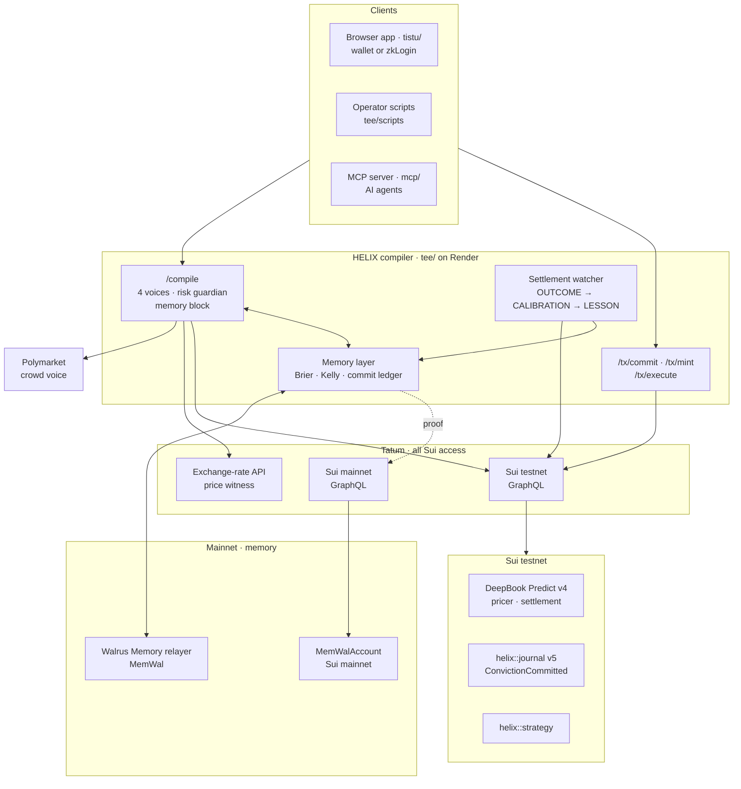

# 🧬 HELIX

### A Living Ecosystem of Composable Financial Convictions on Sui

---

[](https://github.com/harsh11067/helix/actions/workflows/ci.yml)
[](https://overflow.sui.io)
[](https://overflow.sui.io)
[](https://sui.io)
[](./LICENSE)
[](./docs/SUBMISSION.md)

> [!IMPORTANT]
> **Don't build strategies. Express convictions. Watch them live, evolve, and compose.**
> HELIX is not an options platform. It is not a prediction market. It is not a copy-trading app. It is a new category: **conviction-native finance.**

---

## ⚖️ Judges: try in 60 seconds

No wallet needed. (The free-tier compiler may take ~50 s to wake on the first request.)

1. **Open the demo trader:** [helix-app-fovn.onrender.com/app.html?demo=1#/memory](https://helix-app-fovn.onrender.com/app.html?demo=1#/memory) — a real trader's convictions, outcomes, calibration and lessons, recalled live from **Walrus Memory (mainnet)**, read-only.
2. **Check any memory:** click a blob id → **Walruscan mainnet**; click *verify on mainnet* → the MemWal account read through **Tatum's mainnet gateway** plus the blob from the Walrus mainnet aggregator.
3. **See memory change the product:** open the **Canvas** (still in demo mode), move the sliders — the compile uses the demo trader's memory: *you set X · memory suggests Y*, the four voices, and the **Memory** line in the risk guardian.
4. **See Tatum is the chokepoint:** [`/health`](https://helix-compiler.onrender.com/health) shows live testnet + mainnet checkpoints read through Tatum.
5. **Commit as yourself:** connect a wallet (or Google/zkLogin) and press **Commit conviction** — it costs testnet gas only (no USDC). The demo is read-only, so committing and minting unlock only for your own address.

## 🏗️ Architecture



A conviction is compiled against DeepBook Predict's live on-chain pricer, then either **committed** (`journal::commit` stores the sha256 of the conviction before the window settles; gas only) or **minted** as a real Predict order. Either way, HELIX writes it to **Walrus Memory on mainnet**. When the window settles, the watcher reads the settlement through **Tatum**, checks the hash, scores all four voices, and writes the outcome, the new calibration and any lesson back to memory. The next compile reads that memory.

---

## 🧠 Total Recall — new during 20 Oct – 10 Nov 2026

HELIX existed before this hackathon (Move package, DeepBook Predict integration, Seal theses, zkLogin). **Everything below was built in the build window** — the commits on branch `total-recall` are the record.

**HELIX now remembers who was right.** Every conviction carries up to four probability calls on the same outcome — **you** (your confidence), the **Predict market** (implied by DeepBook Predict's on-chain SVI pricer), **HELIX's regime model**, and, when the windows match, the **Polymarket crowd**. Each call, each settled outcome, each recalculated calibration score and each lesson is written to **Walrus Memory on mainnet**, and the next compile visibly changes because of it.

| New in the window | Where |
|---|---|
| **Tatum single chokepoint** — every Sui read, event query and transaction execution goes through Tatum's Sui gateway (GraphQL; Sui retired public JSON-RPC in 2026). Testnet for trading, mainnet for memory proofs. Free-plan rate limit (3 req/s) respected by a serialized queue with jittered backoff and a 2s read cache. The browser never sees the key. | `tee/src/shared/tatum.ts`, `/graphql`, `/rpc`, `/tx/execute` |
| **DeepBook Predict v4** (redeployed 2026-09-12: queued orders filled by a keeper at Pyth's price) — live pricer snapshot, admissible directional / bracketed-range / range orders, server-built PTB that places the Predict order **and** mints the HELIX strategy object in one signature | `tee/src/predict/` |
| **Walrus Memory layer** — CONVICTION / OUTCOME / CALIBRATION / LESSON records, hashed namespaces, Beta(2,2) posterior, Brier per voice, ¼-Kelly commit suggestion, structure bias | `tee/src/memory/` |
| **Commit mode** — the user signs `helix::journal::commit(sha256(conviction), market, expiry)` before the window settles (gas only, no USDC). The CONVICTION memory carries the hash and commit digest; at settlement the watcher re-hashes the memory (`reveal_ok`). Calibration is checked against **every** `ConvictionCommitted` event the address emitted, so a hidden losing call shows up as `missing_memory` and counts as a loss | `contracts/sources/journal.move`, `tee/src/memory/commit.ts`, `/tx/commit`, `/memory/conviction` |
| **Settlement watcher** — resolves every commit and every filled order at expiry, writes OUTCOME → CALIBRATION → LESSON; rebuilt from Walrus Memory on restart (no duplicate writes) | `memory/service.ts` |
| **Memory changes the compile** — "you set X · memory suggests Y" with one-click accept (never silent), memory-preferred structure, a 4th guardian class *Memory* in plain language | Canvas |
| **Memory page** — timeline with every Walrus blob id and an inline **mainnet proof** (MemWal account read via Tatum mainnet + blob fetched from the Walrus mainnet aggregator), Brier per voice, reliability diagram, memory dividend, who-to-trust board | `tistu/js/memory-ui.js` |
| **W1 Crowd voice** (Polymarket BTC 15-min Up/Down, compared only when windows and strikes match) · **W2 Price witness** (Tatum exchange-rate API) · **W3 Memory dividend** · **W5 MCP server + agent skill** · **W6 opt-in reasoning memory** · **W7 who-to-trust board** | see [WIN_FEATURES.md](./WIN_FEATURES.md) |

Verify it yourself:

```bash
C=https://helix-compiler.onrender.com
curl -s $C/health | jq '{tatum_testnet_checkpoint, tatum_mainnet_checkpoint, memwal, memory_network}'
curl -s -X POST $C/rpc -H 'content-type: application/json' -d '{"jsonrpc":"2.0","id":1,"method":"unsafe_transferSui","params":[]}'   # 403 — allowlisted
curl -s $C/memory/<address> | jq '.timeline[] | {type, blob_id}'            # recalled from Walrus Memory (mainnet)
curl -s $C/memory/<address>/proof/<blob_id> | jq .verdict                   # read back through Tatum mainnet
cd tee && node --env-file=../.env scripts/verify-ledger.mjs                 # every memory → a SUCCESS tx + a mainnet blob
```

Evidence (health output, every memory with its blob id and source tx, before/after compile): [TOTAL_RECALL_EVIDENCE.md](./TOTAL_RECALL_EVIDENCE.md).

### Honest limits

- HELIX positions trade on **Sui testnet** (DeepBook Predict v4 testnet, test USDC). **Memory is written on Walrus Mainnet.**
- DeepBook distributes Predict v4 test USDC manually, so most recorded convictions are **commit-mode** (paper) convictions: the hash is committed on-chain before settlement, and the payoff shown is what the structure **would have paid** at the quoted price. Real minted orders are labeled **On-chain** on the Memory page.
- Memories are written by the HELIX service's Walrus Memory account with an **operator-held delegate key**; the hosted relayer embeds and Seal-encrypts, so **the relayer sees plaintext**. User-owned memory spaces are roadmap.
- Calibration with small n is noisy. A Beta(2,2) prior and an n ≥ 3 gate keep early numbers conservative, and the UI always shows n.
- HELIX's own voice is a transparent **heuristic** (regime-tilted market probability), labeled as such; memory scores it like any other voice.
- The crowd comparison covers only at-the-money directional bets over matching 15-min windows; everything else is marked "not compared". Polymarket resolves on a Chainlink TWAP, Predict on Pyth at expiry. Polymarket may be unreachable from some networks — HELIX then shows "unavailable", never a number.
- Indicative payouts on the Canvas use a fee model fitted to Predict quotes; the exact cost and fees come from Predict's own plan at signing. Memory-dividend counterfactuals ignore fills and slippage.
- Some convictions were placed by an operator script (`tee/scripts/commit-campaign.ts`, `tee/scripts/mint-conviction.ts`) on the same server path as the browser; every such memory is tagged `origin=cli`.
- Hardware TEE attestation remains a labeled dev stub (unchanged).

---

### 🚀 Live URLs

```text
┌────────────────┬─────────────────────────────────────┬──────────────────────────────────────────────────────────┐
│                │                 URL                 │                          Status                          │
├────────────────┼─────────────────────────────────────┼──────────────────────────────────────────────────────────┤
│ App (frontend) │ https://helix-app-fovn.onrender.com │ HTTP 200 — landing + /app.html                           │
├────────────────┼─────────────────────────────────────┼──────────────────────────────────────────────────────────┤
│ Compiler (TEE) │ https://helix-compiler.onrender.com │ /health ok, warm /compile 1.15s against real testnet SVI │
└────────────────┴─────────────────────────────────────┴──────────────────────────────────────────────────────────┘
```

* **On-Chain Package — `published-at` (latest, v5, adds `journal`):** `0x5bcf3bf66f6c71f53aaf681842b554edde5b6c141c7315ba0ac6b4cd6766652f`
* **On-Chain Package — `original-id` (v1, type/identity namespace):** `0xdc4b27696494c3c5f54513b19781686f7354a7b09f7ccf2285f7b843c7add2b3`
* **Real Walrus Testnet Blob:** `QE8njhhplCR8s6UHqjS8SBsQ6SO7AxyNZqI6CoBvmX4`
* **Full on-chain proof, IDs, tx digests & explorer links:** [DEPLOYMENT.md](./DEPLOYMENT.md)

> [!NOTE]
> The package has been upgraded **five times** on testnet (v1 publish → v2 Seal policy → v3 cross-wallet copy → v4 copier-access fix → v5 `journal` commit–reveal). Always use `published-at` for `moveCall` targets and `original-id` for type/event identity. The full lineage is in [DEPLOYMENT.md](./DEPLOYMENT.md).

---

## 📑 The Document Set

The design and planning of the HELIX platform are systematically organized under the [docs/](./docs/) folder. Read them in the following order:

| Document | Focus | Purpose |
| :--- | :--- | :--- |
| 📋 **[SUBMISSION.md](./docs/SUBMISSION.md)** | **Honest Submission Proof** | Verdict, locked demo script, Q&A, and live deployment details. |
| 💡 **[idea.md](./docs/idea.md)** | Concept & Vision | High-level overview, user stories, and conceptual diagrams. |
| 🏗️ **[architecture.md](./docs/architecture.md)** | System Architecture | Six-layer design, Move contracts object model, and TEE data flows. |
| ⚖️ **[decisions.md](./docs/decisions.md)** | Tradeoffs & ADRs | Architectural Decision Records explaining the *why* behind design choices. |
| 📅 **[plan.md](./docs/plan.md)** | 8-Week Build Plan | Phase-by-phase backend-first build schedule. |
| 🧪 **[test.md](./docs/test.md)** | Binary Checkpoints | 278 verifiable test checkpoints for incremental progress tracking. |
| 🎨 **[DESIGN.md](./tistu/DESIGN.md)** | UI & Visual Design | High-fidelity UI layouts, bioluminescent theme, and motion specs. |

> [!NOTE]
> Each document is fully cross-referenced. A decision in [decisions.md](./docs/decisions.md) maps to a system component in [architecture.md](./docs/architecture.md), a build phase in [plan.md](./docs/plan.md), and a verification checkpoint in [test.md](./docs/test.md).

---

## ⚠️ The Problem

Three major walls separate retail traders from sophisticated finance:

1. 🧱 **The Knowledge Wall** — Sophisticated trading requires understanding options, Greeks, implied volatility surfaces, and hedging. Most retail users never get past this barrier.
2. 🧱 **The Time Wall** — Managing and adjusting derivative positions is a full-time job. Markets shift constantly, demanding continuous manual intervention.
3. 🧱 **The Trust Wall** — Copy-trading platforms are built on trust-based, easily manipulated, or unverifiable historical records.

### How HELIX Breaks the Walls:
* **Express Convictions, Not Constructs**: The user interacts with high-level views; the AI compiles the underlying legs.
* **Living & Self-Adapting**: Strategies are independent on-chain agents that monitor themselves and react to regime changes.
* **On-Chain Verifiable Lineage**: Every strategy is backed by a cryptographic TEE attestation and has verifiable on-chain DNA.

---

## ⚙️ How It Works

```text
┌─────────────────┐       ┌─────────────┐       ┌─────────────────┐
│ YOUR CONVICTION │ ────> │ AI COMPILER │ ────> │ LIVING STRATEGY │
└─────────────────┘       └─────────────┘       └────────┬────────┘
  "Bullish BTC,             Reads SVI surface,           │ A Sui object with
   choppy, ~1 hour"         picks optimal structure,     │ DNA, a heartbeat,
                            builds the PTB               │ and a lifecycle.
                                                          ▼
                                        ┌─────────────────┴─────────────────┐
                                        │  WHAT IT CAN DO ONCE DEPLOYED:    │
                                        ├───────────────────────────────────┤
                                        │ 🔗 CHAINED to other convictions    │
                                        │ 🧬 BRED with winning DNA          │
                                        │ 👥 COPIED by followers for fees   │
                                        │ 📈 NETTED into one portfolio view │
                                        └───────────────────────────────────┘
```

Five layers, each solving a problem no existing platform solves:

1. **🔮 Conviction Canvas** — Express beliefs (direction, confidence, volatility, time), not individual legs. The AI compiles them.
2. **🌳 Cascading Conviction Trees** — Chain your strategy to other users' outcomes cross-user with undercollateralized credit.
3. **🧬 Strategy DNA & Evolutionary Marketplace** — Strategies breed, lineages emerge, and winning genes propagate.
4. **📊 Greeks Netting Engine** — Institutional portfolio-level risk management in retail DeFi for the first time.
5. **🛡️ Regime-Adaptive Risk Guardian** — Composes with Predict's native PLP liquidity vault and surfaces portfolio risk in plain language before signing.

---

## 🔬 Built on Research, Not Vibes

The HELIX protocol relies on academic rigor rather than marketing claims. Three published papers anchor the live engine, and we are transparent about what is in our core MVP vs. what is on the roadmap:

| # | Academic Paper Reference | Core Application in HELIX | Implementation Status |
| :---: | :--- | :--- | :--- |
| **7** | *Intent-based DeFi* (CoW Protocol / Anoma 2025) | The conviction-as-intent paradigm: the core spine of the product. | 🟢 **Core MVP** |
| **3** | *Deep Learning for Options Trading End-to-End* (Tan/Roberts/Zohren, ICAIF 2024) | Mapping user conviction (directional + volatility bias) to the optimal structure. | 🟢 **Core MVP** |
| **4** | *Gamma/Vega Hedging via Distributional RL* (Cao/Hull et al. 2022) | Risk Guardian auto-hedging logic (rule-based in MVP, RL-guided in V2). | 🟡 **Core (MVP-lite)** |
| **1** | *Neural Network Correction of IV Surface* (Duan, J. Futures Markets 2026) | Modifying Implied Volatility surface logic (superseded by Predict's native SVI). | 🔵 **Roadmap** |
| **2** | *Bidirectional LSTM Option Pricing* (Springer 2026) | Long short-term memory option pricing (requires historical data not yet on Sui). | 🔵 **Roadmap** |

> [!NOTE]
> **Why Papers 1 & 2 are deferred to the roadmap:** DeepBook Predict's oracle (developed with Block Scholes) publishes a live SVI volatility surface natively via `oracle::OracleSVIUpdated`. HELIX reads this surface directly rather than recomputing it via an off-chain neural net. This avoids redundant ML processing and ensures we don't include unused imports or hollow code, respecting the Overflow judging guidelines.

---

## 🛠️ Sui Stack Integration

HELIX is built natively for the Sui blockchain, leveraging its unique features to enable experiences impossible on legacy chains:

* **Move Object Model**: Strategies live as first-class, owned objects on-chain. This enables parallelized transactions and native lineage tracking ([decisions.md](./docs/decisions.md) ADR-001).
* **DeepBook Predict & Margin**: Composes with `predict::mint` for position minting, `predict::supply` for PLP liquidity provision, and `predict::redeem_permissionless` via a dedicated user `PredictManager`.
* **Block Scholes / OracleSVI**: Integrates with Sui's native volatility surface feed to price and hedge positions.
* **dUSDC**: Utilized as the default quote asset on Predict's testnet.
* **Nautilus TEEs**: Verifiable compute environments for the AI compiler, risk hedger, regime classifier, and backtester ([architecture.md](./docs/architecture.md) §4).
* **Walrus**: Low-cost decentralized storage for strategy lineage logs, historical backtests, and TEE attestation verifications.
* **Seal**: Used to encrypt private strategy DNA configurations and govern access control for premium copy-trading.
* **Pyth Network**: Oracle price feeds for secondary spot pricing verification.
* **zkLogin**: Seamless Web2-style onboarding for retail users.
* **Programmable Transaction Blocks (PTBs)**: Atomic, single-transaction deployments of complex multi-leg positions and strategy breeding.
* **dApp Kit & Sui SDK**: Seamless client-side integration and transaction signing.

---

## 🎯 Track Fit & Hackathon Alignment

### 🥇 Primary Focus: Agentic Web → Sub-track 3: Intent Engine (Core)
The sub-track requirements align perfectly with HELIX's design:
> *"Parse a plain-English financial goal, compile it into a Sui PTB, and before signing, run a guardian check that surfaces risks in plain language. The user must explicitly confirm before execution."*

| Intent Engine Deliverable | HELIX Implementation | Status |
| :--- | :--- | :---: |
| **Natural Conviction Parsing** | Conviction Canvas gathers beliefs and compiles them. | ✅ Yes |
| **Human-Readable PTB Preview** | Payoff curves and clear, jargon-free summary before signing. | ✅ Yes |
| **Dual Risk Class Guardian** | Risk Compass checks: stale SVI, thin liquidity, over-concentration, high slippage. | ✅ Yes |
| **Explicit Consent Gate** | "Bring to Life" confirmation modal displaying risk metrics. | ✅ Yes |

> [!TIP]
> HELIX is a true intent engine. It does not just wrapper a basic swap; it manages complex, multi-leg derivative positions with an active, automated risk-guardian layer.

### 🥈 Specialized Track: DeepBook Predict (Secondary)
Integrates the DeepBook Predict contract on testnet end-to-end. HELIX utilizes `predict::mint`, `predict::supply` (PLP), and `PredictManager` accounts, executing trades directly against the live `OracleSVI` volatility surface in `dUSDC`.

### 🥉 DeFi & Payments (Tertiary)
Applies portfolio Greeks netting, intent-compiled structured positions, and asset allocation concepts matching the DeFi track's idea bank.

---

## ⚖️ Meeting the Judges' Actual Bar

To satisfy the strict 2026 Overflow judging criteria (*demo-first verification, genuine stack usage, verifiable activity, and no hollow UIs*), HELIX is built to the following standards:

* **Demo-First Progression**: Our [plan.md](./docs/plan.md) is structured backend-first. By Phase 5, we have a fully testable CLI and end-to-end integration ([test.md](./docs/test.md) checkpoint 5.28) before the UI is completed.
* **No Hollow Code**: Every Sui primitive listed in our stack usage has a critical, functional role in the protocol's execution path.
* **On-Chain Footprint**: Deployed strategies are actual objects that execute verifiable orders on DeepBook Predict.
* **Production-Grade Frontends**: Our design dictates a beautiful interface, and all components are backed by real APIs and indexers — not client-side mocks.

---

## 📂 Repository Directory Layout

```text
helix/
├── README.md                  ← You are here
├── .gitignore                 ← Git exclusion rules
├── vercel.json                ← Vercel deployment spec
├── render.yaml                ← Render blueprint spec
├── contracts/                 ← Sui Move Smart Contracts
│   ├── sources/
│   │   ├── strategy.move
│   │   ├── dna.move
│   │   ├── breeding.move
│   │   └── ...
│   └── tests/
├── docs/                      ← Project Planning & Technical Specs
│   ├── SUBMISSION.md          ← Honest submission proof & Q&A
│   ├── architecture.md        ← Technical architecture specs
│   ├── decisions.md           ← Architectural Decision Records (ADRs)
│   ├── idea.md                ← High-level conceptual overview
│   ├── plan.md                ← 8-week build schedule
│   └── test.md                ← 278 binary verification checkpoints
├── tee/                       ← Nautilus TEE Agent Services
│   ├── src/
│   │   ├── compiler/          ← AI Conviction Compiler
│   │   ├── hedger/            ← Auto-hedging loop
│   │   ├── regime/            ← Volatility regime classifier
│   │   └── backtest/          ← Historical performance testing
│   └── test/                  ← TEE Agent tests (20/20 green)
├── services/                  ← Off-chain indexers and APIs
│   └── indexer/               ← Sui Event Indexer & WS hub
└── tistu/                     ← Deployed Vercel Web Frontend
    ├── app.html               ← App shell Entrypoint
    ├── index.html             ← Landing Page Entrypoint
    ├── DESIGN.md              ← UI visual design spec
    ├── css/
    └── js/
```

---

## 🚦 Project Status

This repository has completed **Phase 5 (Backend Integration)**.
* Move smart contracts are published to testnet.
* Nautilus TEE Agent Services are deployed and running on Render.
* Frontend Web App is deployed and running on Vercel, querying the live compiler and wallet Standard.

Next Steps: Record the final submission demo video and finalize the pitch deck.

---

### 🧬 One-Sentence Summary
*HELIX makes sophisticated finance conversational — you express what you believe, an AI brings it to life as a living on-chain organism, and a public marketplace of conviction lineages emerges from the bottom up.*

> **The first platform where finance becomes biology.**
